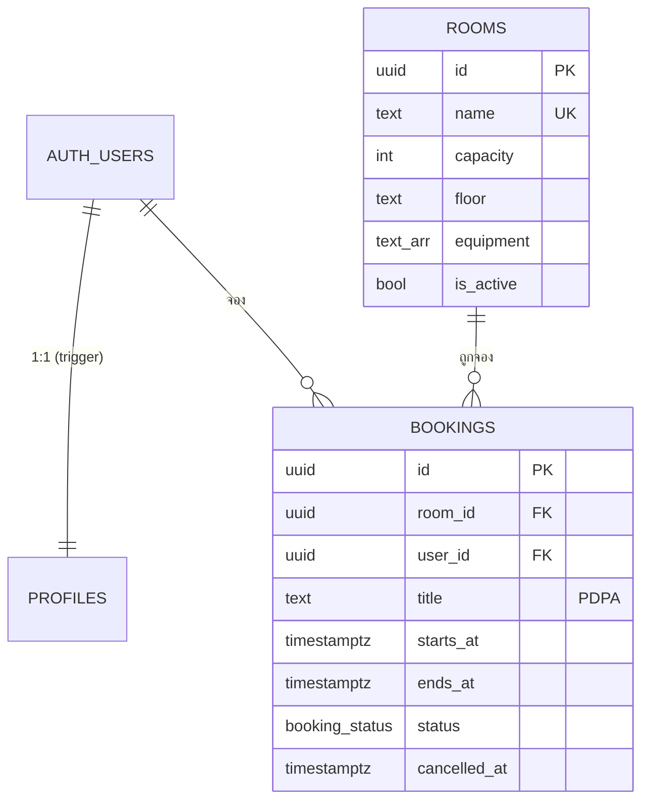
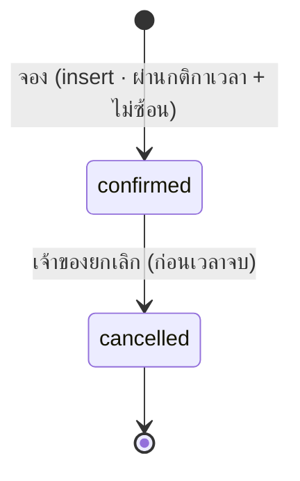

# SYSTEM DESIGN — Profender Room Booking (ร่างตั้งต้น · งาน ROOM-2 จะเติมจาก docs/spec/)

> ส่วน "ตัดสินแล้ว" มาจาก ADR 0001 · ส่วน "รอเติม" ทำในงาน ROOM-2 จาก `docs/spec/` แล้วส่งให้เจ้าของโปรเจคอนุมัติ

## 1. ภาพรวม (รอเติม)
- ปัญหาที่แก้ (จองซ้อน, หาห้องว่างยาก, ห้องถูกจองแต่ไม่มีคนใช้) · บทบาท (พนักงาน, ผู้ดูแลห้อง, ผู้ดูแลระบบ)
- ปริมาณ: จำนวนห้อง, การจอง/วัน, ผู้ใช้พร้อมกัน · KPI (อัตราใช้ห้อง, no-show)

## 2. สถาปัตยกรรม (ตัดสินแล้ว · ADR 0001)
```
แอป Android (Flutter) ──HTTPS──▶ Supabase project (staging | production แยกกัน)
  publishable key + JWT ผู้ใช้        ├─ Auth (GoTrue)
  config จาก --dart-define            ├─ PostgREST ─▶ Postgres (RLS บังคับสิทธิ์ทุกตาราง)
                                      └─ Edge Functions / pg_cron (เมื่อจำเป็น: แจ้งเตือน, ปล่อยห้อง no-show)
```
- **สิทธิ์อยู่ที่ DB**: ทุกตารางเปิด RLS · แอปไม่มีกุญแจสิทธิ์สูง
- **กติกาจองอยู่ที่ DB**: กันเวลาซ้อนด้วย exclusion constraint (`btree_gist`, `tstzrange`) · สถานะการจองเปลี่ยนผ่าน function ที่ตรวจเงื่อนไข
- **แอป**: Riverpod (state) · go_router (route + redirect ตาม auth) · supabase_flutter

## 3. สภาพแวดล้อม
| | Supabase | แอป | ใครเปลี่ยน schema |
|---|---|---|---|
| local | `supabase start` (Docker) | `scripts/dev/run_local.sh` | `supabase db reset` |
| CI | local stack ใน runner ubuntu-latest | web build สำหรับ Playwright + APK debug | `supabase db reset` |
| staging | project แยก | APK จาก `main.yml` (artifact) | คนรัน `supabase db push` |
| production | project แยก (region ตาม ADR 0002) | AAB/APK จาก `release.yml` | คนรัน `supabase db push` ก่อน tag |

## 4. CI/CD (ตัดสินแล้ว)
- PR: risk (+MANUAL_MERGE) · guard + gitleaks · flutter format/analyze/test/build APK · migration บนฐานว่าง + db lint + pgTAP · Playwright API + web
- main: ชุดเดียวกัน + APK staging · release (tag `vX.Y.Z` บน main): ชุดเดียวกัน + AAB/APK เซ็นแล้ว → GitHub Release
- ไม่มี deploy อัตโนมัติไป Supabase · Play Store อัปโหลดด้วยมือ (หรือเพิ่มภายหลังด้วย ADR)

## 5. ข้อมูลและความปลอดภัย (ตัดสินแล้ว + รอเติม)
- PDPA: ข้อมูลส่วนบุคคล = ชื่อ, อีเมล, แผนก, ประวัติการจอง · ผู้ใช้เห็นเฉพาะของตัวเอง + ข้อมูลห้องที่จำเป็น (เช่น "ไม่ว่าง" โดยไม่บอกผู้จองถ้าไม่จำเป็น) · ระยะเก็บประวัติ (รอเติม)
- region/DPA ของ Supabase: ADR 0002 ข้อ 1 ต้องตัดสินก่อน production
- auth: ADR 0002 ข้อ 2 · ห้ามเปิด signup สาธารณะบน production ถ้าใช้อีเมล+รหัสผ่าน (จำกัดโดเมนบริษัทหรือเชิญเท่านั้น)

## 6. โดเมน (ROOM-2/ROOM-4 · ระยะ 1)


| กติกา | บังคับที่ |
|---|---|
| ห้องเดียวกันห้ามจองซ้อน (ยกเลิกแล้วไม่นับ) | exclusion constraint `bookings_no_overlap` (btree_gist + tstzrange `[)`) |
| ทีละ 15 นาที · 15 นาที–4 ชม. · เวลาจบ > เริ่ม | CHECK |
| ไม่จองย้อนหลัง · ล่วงหน้า ≤ 30 วัน · ยกเลิกได้ก่อนเวลาจบ · ยกเลิกแล้วกลับไม่ได้ | trigger `bookings_enforce_rules` |
| เห็น/ยกเลิกได้เฉพาะของตัวเอง · จองในนามคนอื่นไม่ได้ · จองห้องที่ปิดไม่ได้ | RLS + column grant |
| คนอื่นเห็นแค่ช่วงไม่ว่าง (ไม่เห็นชื่อ/หัวข้อ) | `room_busy_slots(from, to)` security definer · ช่วง ≤ 31 วัน |

หน้าจอ (go_router): `/` รายการห้อง + สถานะว่างตอนนี้ + ช่วงไม่ว่างตามวัน · `/rooms/:id/book` ฟอร์มจอง · `/my-bookings` การจองของฉัน + ยกเลิก · `/login`
ระยะ 2: อนุมัติ, จองซ้ำ, เช็กอิน/ปล่อยห้อง, push, ปฏิทิน Outlook, หน้าแอดมินจัดการห้อง
